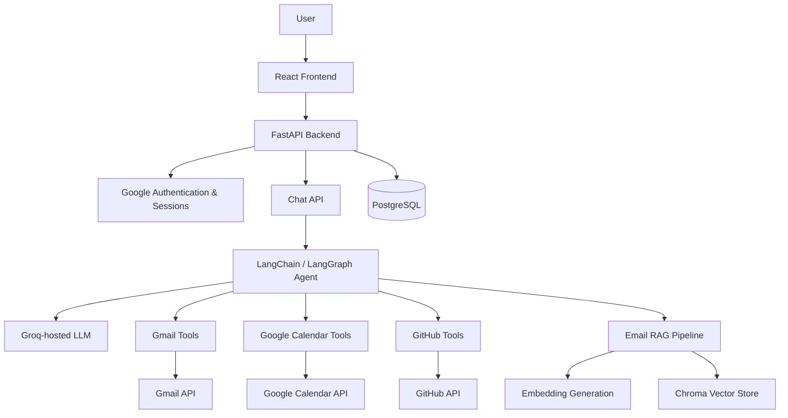

# 🧠 Neuron — Your Second Brain for the Digital World

**One AI assistant. Your emails, schedule, code, and knowledge—connected.**

Neuron is a personal knowledge assistant designed to bring scattered digital information into one intelligent workspace. Instead of manually searching through emails, checking calendars, or navigating code repositories, users can ask questions in natural language and let an AI agent retrieve relevant information from their connected services.

Built with **FastAPI, React, LangChain, LangGraph, Groq, and retrieval-augmented generation (RAG)**, Neuron combines conversational AI with tools that access a user's connected data.

<p align="center">
  <a href="https://neuron-71tk.onrender.com">🚀 Live Application</a>
  ·
  <a href="https://miniproject-neuron.onrender.com/docs">📚 Backend API Docs</a>
</p>

---

## ✨ Why Neuron?

Our digital lives are fragmented across different platforms. Important information lives in emails, meetings are stored in calendars, and technical knowledge is scattered across repositories.

Neuron aims to solve this fragmentation by providing a **single conversational interface for personal digital knowledge**.

Ask a question in plain English. Neuron determines which connected source or tool is relevant, retrieves the information, and generates a contextual response.

## 🚀 Features

### 🔐 Google Authentication
- Sign in using your Google account.
- Maintain an authenticated user session.
- Keep connected services associated with the authenticated user.

### 📧 Gmail Intelligence
- Connect a Gmail account separately from Google sign-in.
- Search recent emails and retrieve message details.
- Access email information through AI-powered conversations.
- Index email content for semantic retrieval using RAG.

### 📅 Google Calendar Intelligence
- Connect Google Calendar.
- Search calendar events using natural-language queries.
- Retrieve schedule information for relevant dates and events.

### 🐙 GitHub Intelligence
- Connect a GitHub account through OAuth.
- Search code across accessible repositories.
- Explore repository information and source-code context.
- Search commit history and inspect relevant development activity.

### 🤖 AI Agent
- Interact with Neuron through a conversational chat interface.
- Use tool-calling to select relevant data sources.
- Combine general reasoning with information retrieved from connected services.
- Maintain conversation history for contextual follow-up questions.

### 🧠 Retrieval-Augmented Generation (RAG)
- Ingest Gmail messages into a vector store.
- Generate embeddings for semantic search.
- Retrieve relevant historical email information for AI responses.
- Distinguish semantic retrieval from live searches of connected services.

---

## 🏗️ Architecture

Neuron follows a modular architecture that separates the user interface, API layer, AI agent, integrations, and data storage.



### Request lifecycle

1. The user authenticates and connects the required services.
2. The frontend sends a request to the FastAPI backend.
3. The backend validates the user's session and loads the conversation context.
4. The AI agent determines whether a connected-service tool or semantic retrieval is appropriate.
5. The relevant tool retrieves information from the authorized source.
6. The model generates a response using the available context.
7. The conversation and response are returned to the frontend.

---

## 🛠️ Tech Stack

| Layer | Technologies |
|---|---|
| Frontend | React, TypeScript, Vite |
| Backend | Python, FastAPI |
| AI orchestration | LangChain, LangGraph |
| Language model | Groq API, configurable model |
| Retrieval | RAG, embeddings, ChromaDB |
| Relational database | PostgreSQL, SQLAlchemy |
| Authentication | Google OAuth, session-based authentication |
| Integrations | Gmail API, Google Calendar API, GitHub API |
| Deployment | Render |

---

## 📁 Repository Structure

```text
miniproject-neuron/
├── backend-neuron/
│   └── app/
│       ├── agents/          # AI agent orchestration
│       ├── api/
│       │   └── v1/          # Versioned API endpoints
│       ├── core/            # Application configuration
│       ├── db/              # Database setup and sessions
│       ├── integrations/    # External service integrations
│       ├── models/          # SQLAlchemy models
│       ├── rag/             # Email ingestion and retrieval
│       ├── services/        # Background and application services
│       └── tools/           # Tools available to the AI agent
├── frontend-neuron-react/   # React web application
├── frontend-neuron-flutter/ # Flutter client workspace
├── android/
├── ios/
├── macos/
└── README.md
```

---

## ⚙️ Getting Started

### Prerequisites

Install the following before running Neuron locally:

- Python 3.12 or compatible version
- Node.js and npm
- PostgreSQL database
- Google Cloud OAuth credentials
- GitHub OAuth application credentials
- Groq API key
- Any additional credentials required by the configured embedding provider

### 1. Clone the repository

```bash
git clone https://github.com/devkaransingh1/miniproject-neuron.git
cd miniproject-neuron
```

### 2. Configure the backend

```bash
cd backend-neuron
python -m venv .venv
```

Activate the virtual environment.

**Windows**

```powershell
.venv\Scripts\Activate.ps1
```

**Linux / macOS**

```bash
source .venv/bin/activate
```

Install dependencies:

```bash
pip install -r requirements.txt
```

Create a `.env` file in `backend-neuron/` and configure the credentials required by the application.

```dotenv
SESSION_SECRET=your_secure_random_secret

DATABASE_URL=your_postgresql_connection_string
# Alternatively, configure DATABASE_URL_POOLED.

FRONTEND_URL=http://localhost:5173

GOOGLE_CLIENT_ID=your_google_client_id
GOOGLE_CLIENT_SECRET=your_google_client_secret
GOOGLE_REDIRECT_URI=your_google_login_callback
GOOGLE_GMAIL_REDIRECT_URI=your_gmail_callback
GOOGLE_CALENDAR_REDIRECT_URI=your_calendar_callback

GITHUB_CLIENT_ID=your_github_client_id
GITHUB_CLIENT_SECRET=your_github_client_secret
GITHUB_REDIRECT_URI=your_github_callback

GROQ_API_KEY=your_groq_api_key
GROQ_MODEL=openai/gpt-oss-120b

COHERE_API_KEY=your_embedding_provider_api_key
```

Use the actual OAuth callback URLs configured for your local environment. Confirm any additional environment variables required by the integration and embedding modules before starting the application.

> **Security:** Never commit `.env` files, OAuth client secrets, API keys, or user access tokens to GitHub.

Start the backend from the `backend-neuron` directory:

```bash
uvicorn app.main:app --reload
```

The API should be available at `http://localhost:8000`. Interactive API documentation is available at `http://localhost:8000/docs`.

### 3. Start the React frontend

Open another terminal:

```bash
cd frontend-neuron-react
npm install
npm run dev
```

Open the local URL printed by Vite, normally `http://localhost:5173`.

### 4. Configure OAuth

Register your local and deployed callback URLs with the relevant providers:

- Google Cloud Console for Google sign-in, Gmail, and Calendar.
- GitHub Developer Settings for GitHub account connection.

Ensure the backend environment variables, provider callback URLs, frontend URL, and CORS configuration agree. Use HTTPS for deployed services.

---

## 🔌 API Overview

The backend exposes versioned API routes under `/api/v1`.

| Capability | Example route |
|---|---|
| Google login | `GET /api/v1/auth/google/login` |
| Current user | `GET /api/v1/auth/me` |
| Logout | `GET /api/v1/auth/logout` |
| Gmail connection | `GET /api/v1/auth/connect/gmail` |
| Calendar connection | `GET /api/v1/connect/calendar` |
| GitHub connection | `GET /api/v1/connect/github` |
| AI chat | `POST /api/v1/chat` |
| Gmail RAG synchronization | `POST /api/v1/rag/sync-gmail` |

For the full route list and request schemas, see the [interactive API documentation](https://miniproject-neuron.onrender.com/docs).

---

## 🔒 Security and Privacy

Neuron is designed around authenticated, user-specific access to connected information.

- API endpoints use the current authenticated user where required.
- Conversation retrieval is scoped to the conversation owner.
- Connected services use their respective OAuth credentials.
- Secrets belong in environment variables, not source code.
- Gmail and Calendar integrations request specific API scopes.

**Important:** OAuth scopes, token storage, session security, and access isolation should be reviewed carefully before broad production use. Do not use real users' sensitive data for testing without appropriate safeguards.

---

## ☁️ Deployment

Neuron currently has a deployed web frontend and backend:

- **Frontend:** [neuron-71tk.onrender.com](https://neuron-71tk.onrender.com)
- **Backend:** [miniproject-neuron.onrender.com](https://miniproject-neuron.onrender.com)
- **API documentation:** [OpenAPI / Swagger UI](https://miniproject-neuron.onrender.com/docs)

Deployment requires correctly configured environment variables, OAuth redirect URLs, CORS origins, and persistent storage for application data. Verify database and vector-store persistence against the selected hosting configuration.

---

## 🗺️ Project Direction

Neuron began with a larger vision: a personal assistant capable of connecting the many sources of a user's digital life. The project has evolved through backend development, OAuth integration, AI tool orchestration, email retrieval, and deployment.

The current focus is making the connected experience more reliable, useful, secure, and production-ready.

Areas for continued engineering include:

- More robust error handling and graceful API quota management.
- Reliable background synchronization and persistent vector storage.
- Stronger OAuth state validation and token lifecycle management.
- Improved observability, automated tests, and deployment workflows.
- Better user-facing integration status and recovery flows.

---

## 👨‍💻 Built With Purpose

Neuron is a project exploring how backend engineering, AI agents, retrieval systems, and third-party APIs can work together to solve a practical problem: **finding and using your own information without manually searching everywhere.**

It is an ongoing engineering project, built iteratively from the initial concept to a deployed, connected AI assistant.

**Repository:** [devkaransingh1/miniproject-neuron](https://github.com/devkaransingh1/miniproject-neuron)

---

<p align="center">
  <b>Neuron — Less searching. More thinking.</b>
</p>
